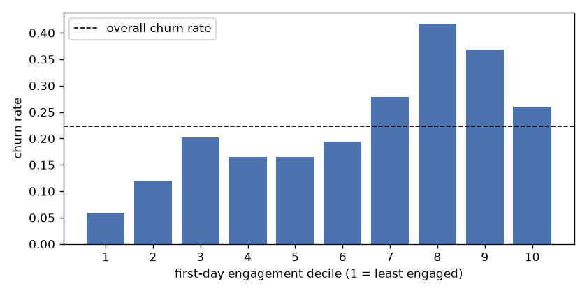
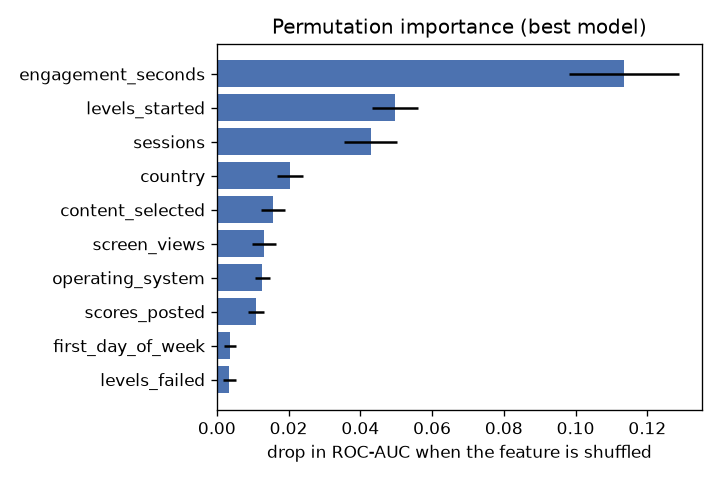

# Player churn prediction

Predicting which players of a mobile game will stop playing, from their first day of event data, and showing how to test whether a retention action actually works.

**Stack:** BigQuery SQL · DuckDB · pandas · scikit-learn · SciPy · pytest

## Results

8,984 players, 22.3% churn. Held-out test set of 1,797 players.

| Model | ROC-AUC (test) | ROC-AUC (5-fold CV) | PR-AUC | Top 20% riskiest: share of all churners reached |
|---|---|---|---|---|
| Logistic regression (baseline) | 0.683 | 0.694 ± 0.016 | 0.342 | 34.5% |
| **Gradient boosting** | **0.735** | **0.754 ± 0.011** | **0.412** | **42.0%** (lift 2.1×) |

- **Useful as a ranking tool.** If a retention team contacts only the 20% of players the model rates riskiest, 46.8% of them churn, against 22.3% for players picked at random: 2.1 times more churners per contact, and 42% of all churners reached.
- **Churn is not "low engagement".** Churn follows an inverted U against first-day play time: lowest for the least engaged players (~6%), peaking at 10 to 20 minutes (~42%), lower again for the heaviest players (~26%). A "binge, then quit" pattern, which is why the tree-based model beats the linear one.
- **What the model relies on:** first-day engagement time, levels started and number of sessions. Several separate sessions on day one go with lower churn; one long sitting goes with higher churn.
- **Not calibrated:** class weighting pushes the scores up, so they rank players well but are not exact probabilities (see `reports/calibration.png`).
- **Experiment design:** detecting a 5-point drop in churn among high-risk players (46.8% to 41.8%) needs 1,549 players per group; a 2-point drop needs 9,741. Notebook 03 shows the sample-size maths, how to read a two-proportion test, and an A/A simulation of the false-alarm rate.




## The question

A player starts playing. Will they come back after their first day?

If we can tell early, the team can act early: a better onboarding level, a nudge, a bonus. The model says *who* to target; an A/B test says whether the action *works*.

## Data

Google's public Firebase sample for the mobile puzzle game **Flood It!**, exported to BigQuery in the GA4/Firebase event schema:

- `firebase-public-project.analytics_153293282.events_*`
- 15,175 players and 5.7 million events, 12 June to 4 October 2018

Free and public: anyone can query it from the [BigQuery sandbox](https://cloud.google.com/bigquery/docs/sandbox) without a billing account.

## Approach

1. **Extract (BigQuery SQL)** - `sql/01_player_features.sql`, one row per player.
   - **Label:** *churned* if the player shows no activity after their first 24 hours.
   - **Excluded:** bounces (gone within 10 minutes) and players first seen in the last 48 hours of the export, who had no chance to come back (right-censoring).
   - **Features:** behaviour in the first 24 hours only (sessions, engagement time, screens, levels started / completed / failed / reset, scores posted, content selected) plus context (country, platform, day of week, hour). Using only first-day data avoids leakage: the model never sees what happened after the moment it predicts.
2. **Explore** - `notebooks/01_exploration.ipynb`: churn by platform and country, churners vs. players who stayed, the engagement curve.
3. **Model** - `src/churn/train.py`, walked through in `notebooks/02_model.ipynb`: stratified 80/20 split, logistic regression vs. gradient boosting, class weighting for the 22/78 imbalance, 5-fold cross-validation, ROC-AUC, PR-AUC, precision/recall, lift, permutation importance and calibration.
4. **Experiment** - `src/churn/abtest.py`, walked through in `notebooks/03_ab_test.ipynb`: two-proportion z-test with confidence interval, sample size per group, A/A simulation. Plain formulas, checked in the tests against SciPy's chi-square test and textbook values.

## Limitations

- The export starts on 12 June 2018, so most players were already playing before it began; only a few hundred have a `first_open` (install) event. "First day" means *first day seen in the export*, not the install day.
- One game, one period, 2018 data. The method transfers; the exact numbers do not.
- The A/B test in notebook 03 is a design and a simulation, not a real experiment.

## Repository layout

```
sql/          BigQuery extraction query
src/churn/    data loading, features, training, A/B test functions
notebooks/    01 exploration, 02 modelling walk-through, 03 A/B test
tests/        pytest: A/B test maths and model pipeline
data/         local extract (not committed)
reports/      metrics.json and figures
```

## Reproduce

```bash
# 1. extract (needs a Google Cloud project; the free sandbox works)
bq query --use_legacy_sql=false --format=csv --max_rows=100000 \
  < sql/01_player_features.sql > data/player_features.csv

# 2. train, evaluate and write reports/ (converts the CSV to Parquet on first run)
uv sync
uv run python -m churn.train

# 3. tests and notebooks
uv run pytest
uv run jupyter lab notebooks/
```

## Credits

Churn definition and dataset follow Google's public guide on churn prediction for game developers with GA4/Firebase data. The modelling here is done in Python rather than BigQuery ML.

## License

MIT
